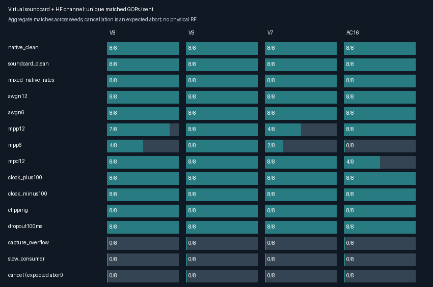
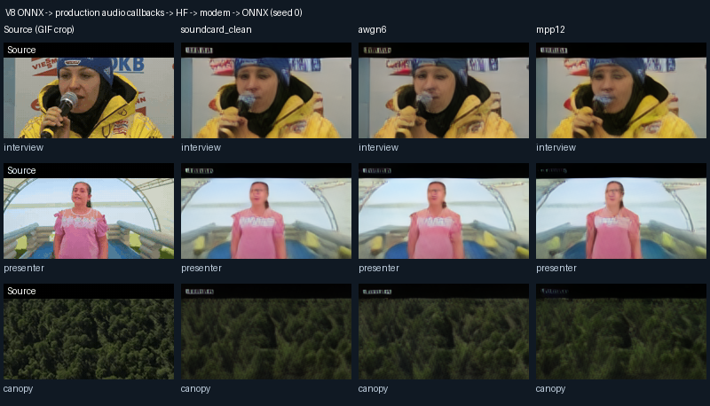

# Production audio path and HF-channel bench — 2026-10-11

## Result

The hardware-free audio bench passes its clean-transport, cancellation and
recovery checks. It executes the real application audio adapters, not only a
modem-to-modem NumPy sweep. The full run exercised **120 synthetic trials**
(four release modes × 15 conditions × two seeds, four GOPs each), three longer
recovery checks, and the real **V8 ONNX encoder and decoder** through three
channel profiles. No Torch was installed; no radio, PTT, or real audio device
was opened.

- Clean native, 48 kHz-device, and 48→44.1 kHz-device paths recovered **96/96**
  transmitted GOPs across V8/V9/V7/AC16.
- AWGN at 12 and 6 dB: **64/64** matched GOPs.
- ±100 ppm endpoint clock mismatch: **64/64** matched GOPs.
- Hard clipping and a 100 ms RF dropout: **64/64** matched GOPs, with degraded
  latent error recorded individually. Delivery is not equivalent to picture quality.
- MPP12: **27/32**; MPP6: **14/32**; disturbed multipath at 12 dB: **28/32**.
  These are measured stress outcomes, not all-pass requirements. Severe fades
  genuinely cause loss; two seeds are not statistical RF certification.
- Every mid-GOP cancellation aborted the virtual endpoint. Each native write
  contains at most 20 ms of audio at these tested rates. This bounds the
  interval between cancellation checks, **not wall-clock stop latency** on a
  stalled driver or while the producer is computing its next block.



Full measurements, sample counts, faults, timing, model checksums, and every
GOP's correlation/NMSE are in [results.json](validation/audio-path/results.json).
A match means maximum post-reception latent correlation >0.25; this oracle is
used only for scoring and is never supplied to receiver acquisition.

## Actual components and deliberate limits

The signal path is:

1. Production `modulate_continuous_chunks`, real headers/pilots/conditioning.
2. Production `_play_chunk_stream_direct`, native-rate `StreamResampler`,
   bounded blocking `OutputStream.write` operations, and finite-stream flush.
3. Virtual DAC clipping/gain → whole-trace HF Watterson/AWGN channel at native
   TX sample rate → optional RF silence dropout → independent RX-clock rate
   conversion, including ±100 ppm skew.
4. Production `_open_input_stream_direct` input callback, irregular native
   callback sizes, native→modem resampling, and real `RingBuffer` writes.
5. Virtual consumer polling every approximately 20 ms, real ring reads and
   overflow detection, then production `StreamingDemodulator`.
6. For the learned check only, real ONNX frame encode before step 1 and real
   ONNX frame decode after step 5, including modem confidence weights.

The native sounddevice endpoint is replaced, not the application adapter or
its callback. The channel processes a complete endpoint trace to retain
continuous fading/filter history; callback fragmentation is applied afterward.
The deterministic clock intentionally accelerates execution. It does not model
OS thread jitter, measure live driver latency, or prove CPU deadlines. The
harness patches the audio backend process-wide and must run separately from a
live station. It does not exercise Station/TxEngine/RxEngine orchestration;
those are covered by the separate station and CAT tests.

PortAudio is not installed in this cloud environment; importing the real
sounddevice backend reports `PortAudio library not found`. Windows WASAPI,
actual soundcard routing, USB latency, driver buffer sizes, I/Q stereo physical
routing, and over-the-air operation remain unvalidated here. Existing stereo
I/Q and WASAPI protocol unit tests still pass, but are not hardware validation.

## Combined station, audio and Hamlib test

Six additional integration cases in `tests/test_hamlib_dummy.py` close the TX
orchestration gap: actual `TxEngine._keyed_send_stream` → production
`play_chunk_stream` → virtual 48 kHz output → AWGN12 HF channel → 44.1 kHz
input callbacks → real resampling/ring → production V8 demodulator. The
control side uses **the actual Hamlib model-1 Dummy**, through either the
native library or a loopback TCP rigctld daemon, never a physical rig.

For both native and TCP control, complete transmission, mid-write Cancel, and
an injected output-write exception passed. PTT readback is ON during every
write and OFF during cleanup; completed cases recovered both synthetic GOPs
with correlation >0.9. Cancellation aborted the virtual endpoint after
350–370 ms of **virtual audio**, and error cases reached the failed station
state with the injected error reported. Both audio endpoints closed.

These combined tests execute TxEngine and real Hamlib control together with
the audio/HF path. They still do not run RxEngine's GUI/background scheduling,
the learned codec in that same station test, or physical audio/RF hardware.
They skip explicitly if the actual Hamlib library/daemon is unavailable; a
skip is not a control-path pass. See the [Hamlib bench report](hamlib-validation-20261011.md)
for executable setup and the wider PTT fault-injection coverage.

## Discontinuity recovery is slower than ordinary fades

RF silence dropout retains the sample timeline; capture overflow removes
samples. They must not be treated as equivalent impairments.

A reported capture overflow at 1.5 seconds, or an initial consumer stall that
wraps a 250 ms ring, resets acquisition. The continuous waveform has only **one
initial preamble**, so a four-GOP burst did not recover after either reset.
In a 16-GOP V8 check, both cases reacquired and recovered GOP indices **10–15**
(6/16), with correlation >0.9 and low latent error. This confirms recovery, but
also a substantial disruption on short transmissions.

A separate two-transmission check deliberately interrupted the first burst.
The next fresh preamble recovered both GOPs of the second burst (indices 2 and
3) without restarting the application. Restarting transmission is a practical
way to accelerate synchronization after a capture fault. These checks are now
part of the CLI's pass/fail criteria whenever V8 is selected.

## Learned video, actually executed



All three distinct source GOPs were encoded and reconstructed through clean,
AWGN6, and MPP12 audio paths: **9/9 learned GOPs, 54 reconstructed frames**.
The source images are the six-frame source cells cropped from the repository's
existing interview, presenter, and canopy GIF grids. They include the source
label overlay and GIF quantization; this is an integration check, not a new
held-out natural-video quality benchmark.

The pinned V8 runtime manifest, encoder, and decoder SHA-256 checksums all
match `RELEASE_RUNTIME_FILES['V8']`. The JSON contains the exact hashes.
Per-scene reconstructed PSNR ranges:

- Clean: 21.91–24.55 dB
- AWGN6: 21.17–24.09 dB
- MPP12: 21.25–23.63 dB

Encoding three GOPs took 2.99 seconds; individual decode calls took about
**1.52–1.73 seconds per one-second GOP** with two configured CPU threads.
Consequently this cloud CPU configuration **does not meet live real-time
learned-decode throughput**. Transport success must not be presented as a
real-time end-to-end performance pass. Other release modes were exercised with
synthetic latents, not learned-model inference.

### CPU throughput follow-up

The existing `benchmark_inference.py` was then run separately, after the test
workers finished, with two warmups and five measured repetitions per setting.
ONNX Runtime 1.23.2 saw nine logical CPUs. These isolated V8 timing probes use
random RGB inputs and zero latents; they do not include transport, rendering,
physical audio, or sustained live scheduling.

| CPU threads | Encode median | Decode median | Sequential cycle median |
|---|---:|---:|---:|
| Backend default | 460.38 ms | 809.23 ms | 1287.98 ms |
| 4 | 546.41 ms | 932.81 ms | 1462.64 ms |
| 8 | 484.93 ms | 659.00 ms | 1144.74 ms |

The default and eight-thread isolated measurements are below one second for
each half-duplex operation. Eight threads gave the best measured decode margin
in this small probe. Every sequential encode-plus-decode cycle remained above
one second, and no result proves full-duplex or sustained real-time station
operation. The original two-thread learned-path measurement remains valid for
that configuration; it is not a hardware-wide performance ceiling. No runtime
defaults were changed. Re-run the packaged benchmark on the intended station
before choosing a thread setting.

Evidence: [default](validation/audio-path/cpu-threads-0.json),
[four threads](validation/audio-path/cpu-threads-4.json), and
[eight threads](validation/audio-path/cpu-threads-8.json). Reproduce each with:

```sh
AETV_OFFLINE=1 OPENBLAS_NUM_THREADS=1 OMP_NUM_THREADS=1 .venv/bin/python \
  scripts/benchmark_inference.py --mode V8 --device cpu \
  --checkpoint /path/to/v8-hf3k-mpp12-ft.runtime.json \
  --threads 8 --warmup 2 --repeats 5 --json cpu-threads-8.json
```

## Reliability fixes found by the bench

- Native TX now drains the streaming rate converter exactly once. Previously
  its final FIR context was withheld at stream end (for example, 21 source
  samples for 8→48 kHz). Randomized short/long and fractional-ratio regression
  cases match one-shot SciPy resampling, including exact output length.
- Whole-GOP blocking writes are split into endpoint-sized blocks. Stop aborts
  queued native output instead of waiting for an entire GOP to drain. The
  first write's startup-only underflow is tolerated; after waveform output has
  begun, an underflow aborts and reports `soundcard output underrun;
  transmission stopped`. This is intentionally stricter than silently sending
  corrupted audio. First-call behavior and True/False/None write return values
  are tested, but backend-specific behavior still needs a real-device check.
- The resampler rejects invalid ratios and appends after final flush; repeated
  flush is safely empty. Capture errors, ring loss and resource cleanup are
  tested explicitly rather than inferred from successfully decoded GOPs.

## Reproduce

Run from the repository root with its existing environment:

```sh
OPENBLAS_NUM_THREADS=1 OMP_NUM_THREADS=1 .venv/bin/python \
  scripts/validate_audio_path.py --output-dir docs/validation/audio-path
```

This produces JSON and a PNG chart in roughly 2–3 minutes on this cloud CPU.
The four release modes and two seeds are defaults. A quick subset is:

```sh
OPENBLAS_NUM_THREADS=1 OMP_NUM_THREADS=1 .venv/bin/python \
  scripts/validate_audio_path.py --modes V8 --seeds 1 --gops 2 \
  --scenarios soundcard_clean mixed_native_rates cancel \
  --output-dir /tmp/aetv-audio-quick
```

A native-clean control is always included, even for stress-only selections.
Exit status is nonzero on required baseline/cancellation/recovery failure.
Impaired-profile loss remains explicitly reported rather than causing a
misleading blanket failure. Invalid arguments/model errors also fail visibly.
V8 selections additionally run the fixed 16-GOP and fresh-transmission recovery
checks. Other selected modes do not claim that longer recovery coverage.

To include learned video, supply an already installed V8 runtime manifest:

```sh
OPENBLAS_NUM_THREADS=1 OMP_NUM_THREADS=1 AETV_CPU_THREADS=2 \
  .venv/bin/python scripts/validate_audio_path.py \
  --onnx-manifest /tmp/aetv-models/v8-hf3k-mpp12-ft.runtime.json \
  --output-dir docs/validation/audio-path
```

The optional flag performs no download and no Torch installation. The normal
application Model Manager can install the pinned ONNX runtime; adjust the path
to its local manifest. Learned video also requires the checked-in demo GIFs.

```sh
OPENBLAS_NUM_THREADS=1 OMP_NUM_THREADS=1 .venv/bin/python -m pytest -q \
  tests/test_audio_path_validation.py tests/test_audio_io.py
```

Final focused result: **55 passed**. This is focused audio coverage, not a
substitute for the repository-wide suite or physical device commissioning.
